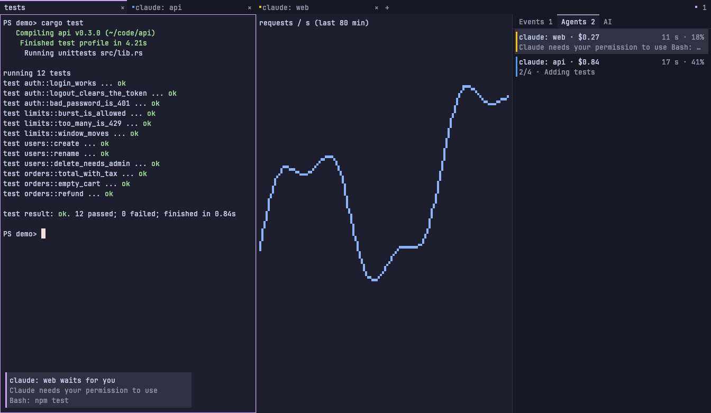
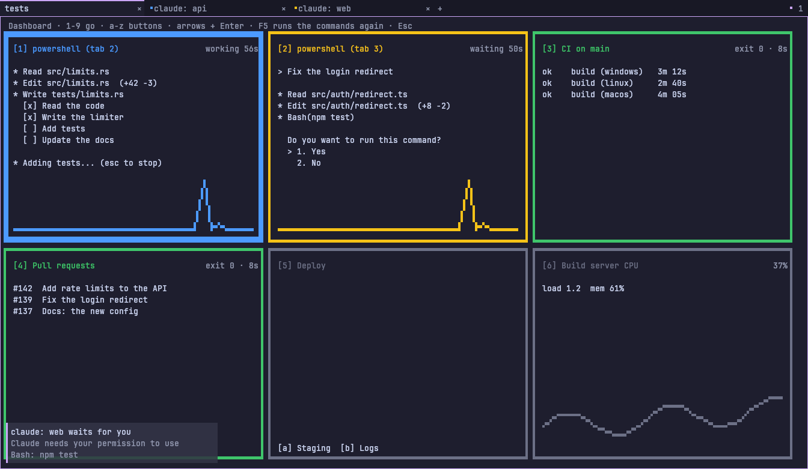
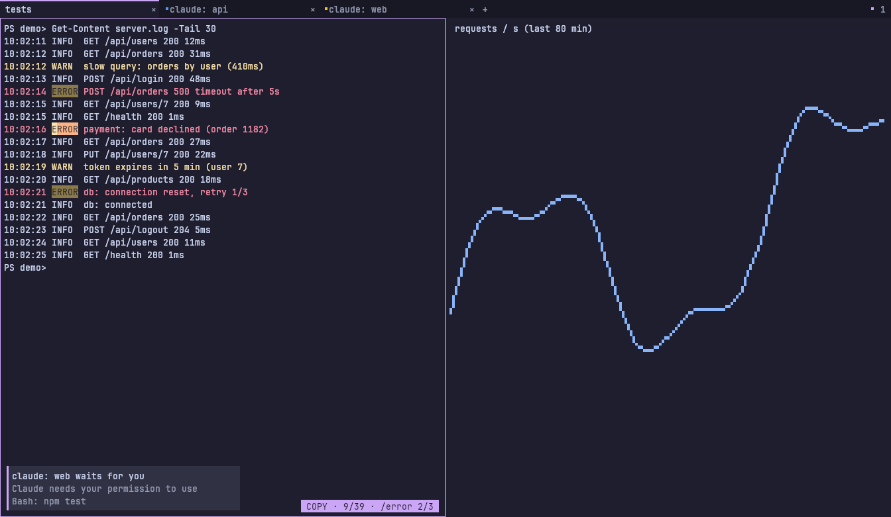

# fterm

fterm is a fast GPU terminal for Windows, Linux, and macOS. It is made for work with AI agents:
it shows what each agent does, and agents can use it too.

## What it can do

### Work with AI agents
- **Agent states on the tabs.** A dot shows when Claude Code works (blue), waits for you (yellow), is done
  (green), or failed (red). fterm tells you when an agent in another tab waits. See [docs/CLAUDE.md](docs/CLAUDE.md).
- **The Agents panel** (Ctrl+Shift+A). The agents that wait for you come first, with their real question. You
  also see the todo of each agent ("2/4 · Adding tests"), the cost of its session, and the context used. H lists
  the past conversations of its folder, and Enter brings one back.
- **Review a plan** of Claude Code item by item: Ok, comment, change, or remove each item. See
  [docs/REVIEW.md](docs/REVIEW.md).
- **An API and an MCP server for agents.** An agent can open a pane, run tests there, read the output, wait for
  an event, and send a message to the agent in another pane. See [docs/API.md](docs/API.md) and
  [docs/MCP.md](docs/MCP.md).
- **The AI panel** (Ctrl+Shift+I) talks to Claude, Ollama, or an OpenAI-like API. It can explain the last error
  (Ctrl+Shift+Y) or turn a task into a command (Ctrl+Shift+G). See [docs/AI.md](docs/AI.md).

### Tabs and panes
- Tabs, split panes, zoom, and **workspaces** (groups of tabs, Ctrl+Alt+W).
- **Overlays:** run a program in a box over a pane, for example lazygit or a file manager (Ctrl+Shift+L).
  A **scratch shell** drops down from the top (Ctrl+`).
- **Companions:** a small strip of a pane for a second program, for example a test watcher next to an agent.
- **Recent panes:** Alt+` goes back to the pane that you used before.
- **Panes that live on** after the window closes, like tmux, also on other machines over SSH. See
  [docs/MUX.md](docs/MUX.md).
- **Sessions:** when fterm starts, it can bring back your tabs, their folders, and the Claude conversation of each
  pane.
- **The dashboard** (Ctrl+Shift+D): tiles with your agents, the output of commands, and buttons.

### Text, search, and copy
- **Copy mode** (Ctrl+Shift+X): move with vi keys, search the history (`/`), select, and copy without the mouse.
  All its keys can be changed in the config. See [docs/KEYS.md](docs/KEYS.md#copy-mode-keyboard).
- The selection stays when new output comes, and you can scroll while you select.
- **Link hints** (Ctrl+Shift+U): a label on each link of the screen; type the label to open it.
- **Shared history** of commands and folders for all windows (Alt+F8, Alt+F12).

### Charts and pictures
- **Braille scenes:** scripts and agents draw charts and pictures in a pane with Braille dots. See
  [docs/SCENE.md](docs/SCENE.md).
- **Pictures in panes:** PNG and JPEG from `ftermctl image`, the iTerm2 picture code, or the clipboard. See
  [docs/PICTURES.md](docs/PICTURES.md).

### Your config
- One Lua file (`fterm.lua`) for keys, profiles, commands, the dashboard, and your own functions. fterm reads it
  again when you save it. See [docs/CONFIG.md](docs/CONFIG.md).
- **Themes** for the terminal and the UI. Colors of programs can fit the theme. See
  [docs/THEMES.md](docs/THEMES.md).
- The UI can be in other languages. See [docs/L10N.md](docs/L10N.md).

## Download
Take the archive for your system from [Releases](https://github.com/newenclave/fterm/releases), unpack it,
and start `fterm.exe` (Linux and macOS: `./fterm`). There is no install: the config (`fterm.lua`) and the
data (`data/`) are in the same folder, so you can move the folder or carry it on a USB drive.

## More
- What is new in each version: [CHANGELOG.md](CHANGELOG.md)
- All keys and the mouse: [docs/KEYS.md](docs/KEYS.md)
- The plan: [docs/ROADMAP.md](docs/ROADMAP.md)
- How to build: [docs/BUILD.md](docs/BUILD.md)
- How it works: [docs/ARCHITECTURE.md](docs/ARCHITECTURE.md)

## License
fterm is under the MIT license ([LICENSE](LICENSE)). It has the JetBrains Mono font inside (SIL Open Font
License, [assets/fonts/OFL.txt](assets/fonts/OFL.txt)) and code from alacritty_terminal (Apache-2.0); see
[THIRD-PARTY-NOTICES.md](THIRD-PARTY-NOTICES.md).
